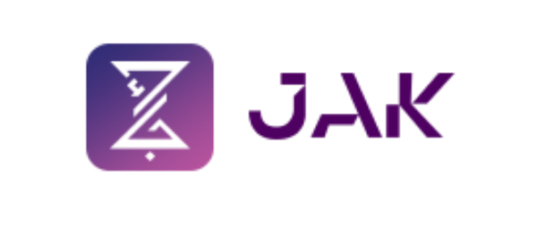

<div align="center">

  

  # ☕ JAK Storefront & API Workspace

  **Enterprise-grade B2B Food & Coffee Supply Platform for the Kingdom of Saudi Arabia**  
  *Reconstructing and modernizing [jak.sa.com](https://jak.sa.com) with bleeding-edge web technology.*

  <p align="center">
    <a href="https://nextjs.org"></a>
    <a href="https://react.dev"></a>
    <a href="https://www.typescriptlang.org"></a>
    <a href="https://tailwindcss.com"></a>
    <a href="https://dotnet.microsoft.com/apps/aspnet"></a>
  </p>

  <p align="center">
    <a href="https://github.com/food-drink-solution/jak-SA-Coffee-F/releases"></a>
    
    
    
    
    
  </p>

</div>

---

## 🌟 Overview

**JAK** is a premier Saudi wholesale supplier providing cafés, restaurants, and retail branches with ready-to-eat bakery goods, specialty coffee beans, machines, syrups, and packaging solutions across all regions of Saudi Arabia.

This workspace is a **production-ready monorepo** housing the modern Next.js frontend storefront alongside the planned ASP.NET Core backend REST API.

---

## 📂 Repository Architecture

```
jak-storefront/
│
├── 🎨 jak-sa/                  # Frontend Next.js 16 Storefront
│   ├── src/                    # Application code (App Router, components, domains)
│   │   ├── app/[lang]/         # Localized routes (/ar and /en)
│   │   ├── components/         # Atomic UI, layout, products, sections
│   │   ├── config/             # Locales, site branding, metadata
│   │   ├── features/cart/      # Isolated Cart domain & storage
│   │   └── lib/                # Catalog repository, i18n dictionaries, utils
│   ├── public/                 # Authentic SVG logos, favicons, product media
│   ├── tests/                  # Unit suites (Vitest) & E2E smoke tests (Playwright)
│   ├── package.json            # Frontend scripts & dependencies
│   └── tsconfig.json           # Strict TypeScript configuration
│
├── ⚙️ server-api/              # Backend ASP.NET Core REST API
│   ├── README.md               # Backend API specifications & roadmap
│   └── .gitkeep                # Reserved workspace scaffold
│
├── 📖 docs/                    # In-Depth Monorepo Documentation
│   ├── ARCHITECTURE.md         # Full system design, data flow, & domain models
│   ├── STYLES.md               # Centralized design tokens & typography scale
│   ├── COMPONENTS.md           # Component guidelines, props & composition patterns
│   └── DEVELOPMENT.md          # Complete local setup, workflow & quality gates
│
├── 🛠️ scripts/                 # Automation & Data Utilities
│   ├── crawl/crawl.mjs         # Safe migration crawler for catalog data
│   └── validate-data.mjs       # Dataset sanity & bilingual schema validator
│
├── package.json                # Root workspace convenience scripts
└── README.md                   # Workspace overview & quickstart
```

---

## 🚀 Key Platform Features

| Feature | Description | Status |
|---------|-------------|:------:|
| **Authentic JAK Identity** | Official JAK brand SVG logo, favicon, and deep royal purple (`#4e0161`) palette. | ✅ Active |
| **Arabic-First Bidirectional UX** | Native Arabic RTL typography (PingARLT/Almarai) with full English LTR toggle. | ✅ Active |
| **Static Site Generation (SSG)** | Instant page loads with pre-rendered product catalogs, categories, and static pages. | ✅ Active |
| **Fluid 4-Tier Responsiveness** | Seamless transitions from ultra-narrow phones (320px) to wide 4K desktop screens. | ✅ Active |
| **Cart Experience** | Interactive slide-out drawer with optimistic updates and local storage persistence. | ✅ Active |
| **Balanced Hero Composition** | Dynamic slide carousel with responsive typography and desktop quick-highlights card. | ✅ Active |
| **Zero Layout Shift & Void Fixes** | Strict overflow controls, no rogue margins, and full viewport height balance. | ✅ Active |
| **Strict Type Safety** | 100% strict TypeScript typing across all components, props, and schemas. | ✅ Active |

---

## 🎨 Design System & Color Tokens

Centralized in `jak-sa/src/app/globals.css` using modern CSS variables and Tailwind CSS v4 design tokens:

| Token | Hex Code | Visual Preview | Usage |
|-------|:--------:|:--------------:|-------|
| `--color-jak-primary` | `#4e0161` | `🟣 Deep Purple` | Header, primary CTA buttons, links, active rings |
| `--color-jak-accent-gold` | `#b88539` | `🟡 Warm Gold` | Special offers, quality badges, awards |
| `--color-jak-accent-pink` | `#e83e8c` | `🌸 Magenta Pink` | Accent tags, badges, decorative elements |
| `--color-jak-violet` | `#82588d` | `🪻 Soft Violet` | Secondary accents, borders, subtle text |
| `--color-surface` | `#ffffff` | `⚪ Pure White` | Card containers, modals, clean surfaces |
| `--color-surface-muted` | `#f8f9fa` | `🌫️ Off-White` | Neutral backgrounds, skeleton loaders |

---

## ⚡ Quick Start

### 1. Prerequisites
- **Node.js** `v18.17+` or `v20+`
- **pnpm** `v9+` or `v12+` (recommended)

### 2. Installation & Setup
```bash
# Clone the repository
git clone https://github.com/food-drink-solution/jak-SA-Coffee-F.git
cd jak-SA-Coffee-F

# Navigate to the storefront
cd jak-sa

# Install dependencies
pnpm install

# Start the Next.js development server
pnpm dev
```

> **Convenience Root Runner:**  
> You can also run commands directly from the root workspace:
> ```bash
> pnpm dev          # Launches frontend dev server
> pnpm build        # Builds production bundle
> pnpm test         # Executes Vitest test suite
> pnpm typecheck    # Runs TypeScript compiler check
> ```

Open [http://localhost:3000](http://localhost:3000) in your browser. The app will automatically detect your preference and route to `/ar`.

---

## 🧪 Quality Gates & Verification

All quality gates pass with zero warnings or errors:

```bash
# Run unit tests (44 tests across 7 suites)
pnpm test

# Run TypeScript compiler check (strict mode)
pnpm typecheck

# Run ESLint validation
pnpm lint

# Validate scraped catalog dataset
pnpm validate:data
```

---

## 📚 Technical Documentation

Explore detailed documentation in the [`docs/`](docs/) directory:

- 🏛️ **[Architecture Guide](docs/ARCHITECTURE.md)** — Monorepo design, data access repository pattern, and state management.
- 🎨 **[Design System & Styles Guide](docs/STYLES.md)** — Design tokens, color system, typography, and responsive scales.
- 🧩 **[Component Development Guide](docs/COMPONENTS.md)** — Primitives, CVA variants, layout components, and accessibility patterns.
- 💻 **[Development Workflow](docs/DEVELOPMENT.md)** — Setup instructions, commands, git conventions, and deployment.
- 🤝 **[Contributing Guidelines](CONTRIBUTING.md)** — How to contribute, branching strategies, and PR guidelines.
- 📋 **[Changelog & Releases](CHANGELOG.md)** — Automated release workflows, tagging conventions, and version history.

---

## 📄 License & Attribution

- **Project:** JAK Storefront Platform
- **Reference Site:** [jak.sa.com](https://jak.sa.com)
- **Repository:** [food-drink-solution/jak-SA-Coffee-F](https://github.com/food-drink-solution/jak-SA-Coffee-F)
- **License:** Private & Proprietary — All rights reserved.
